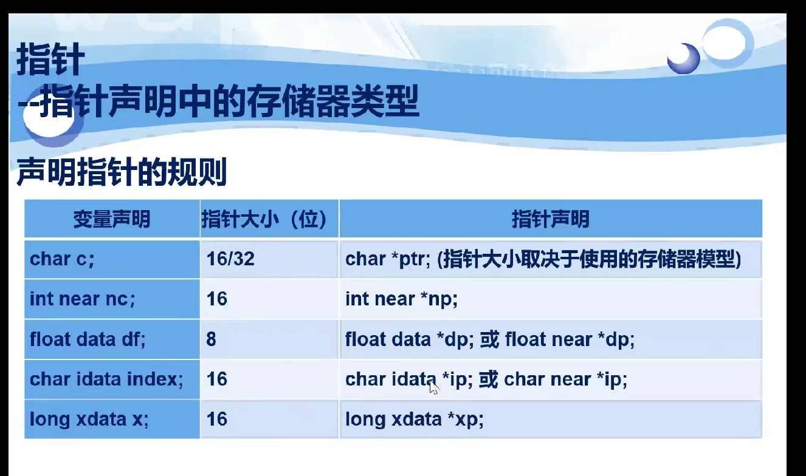
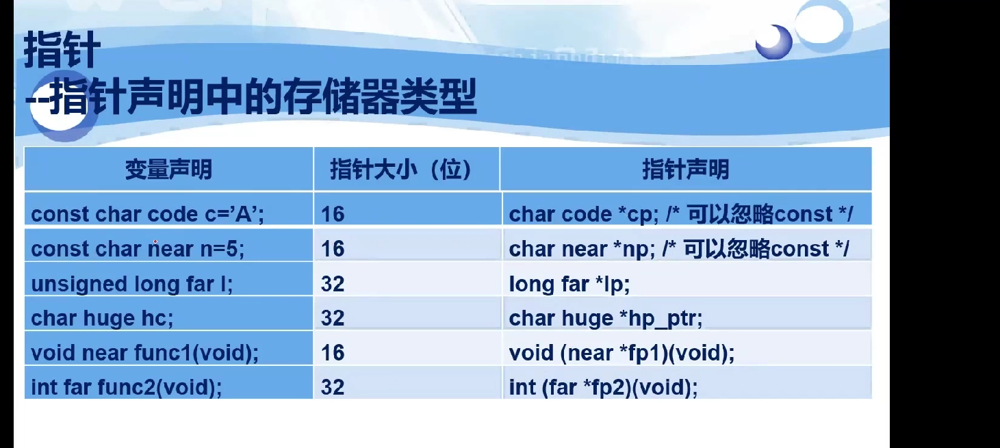
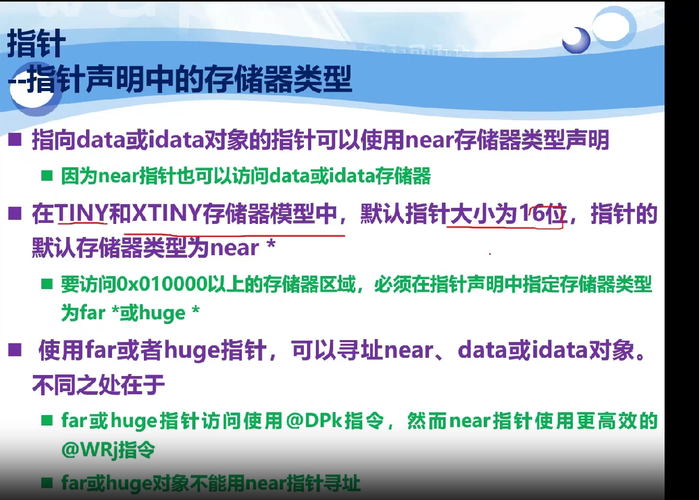
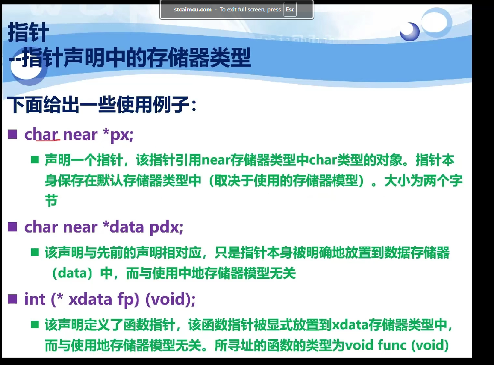
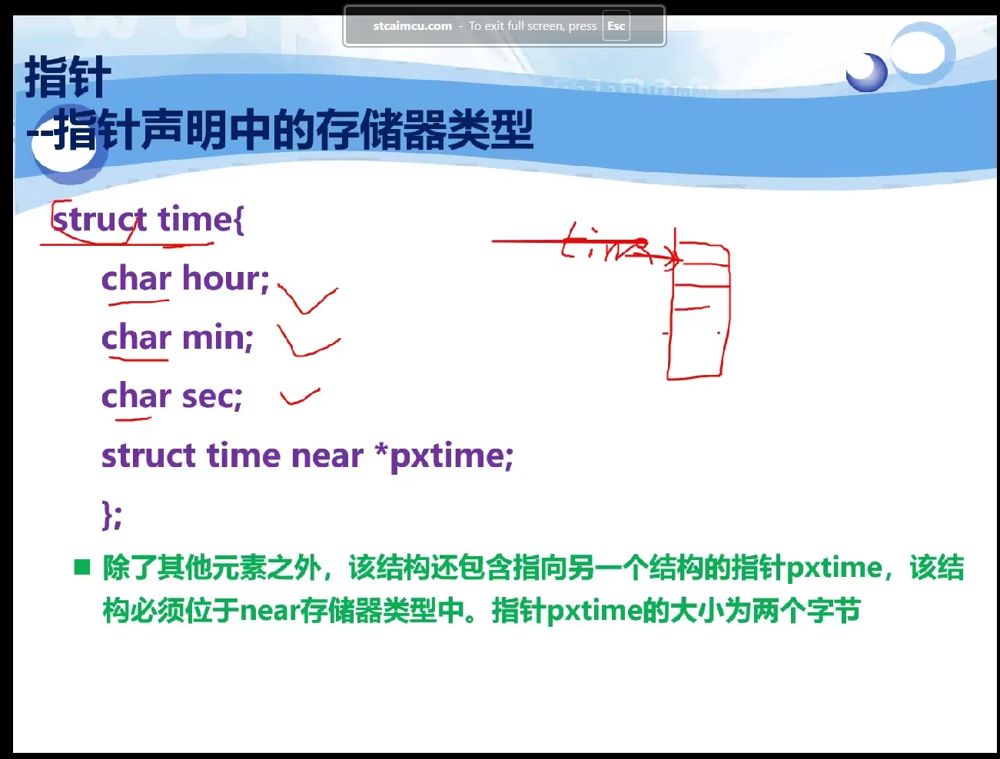
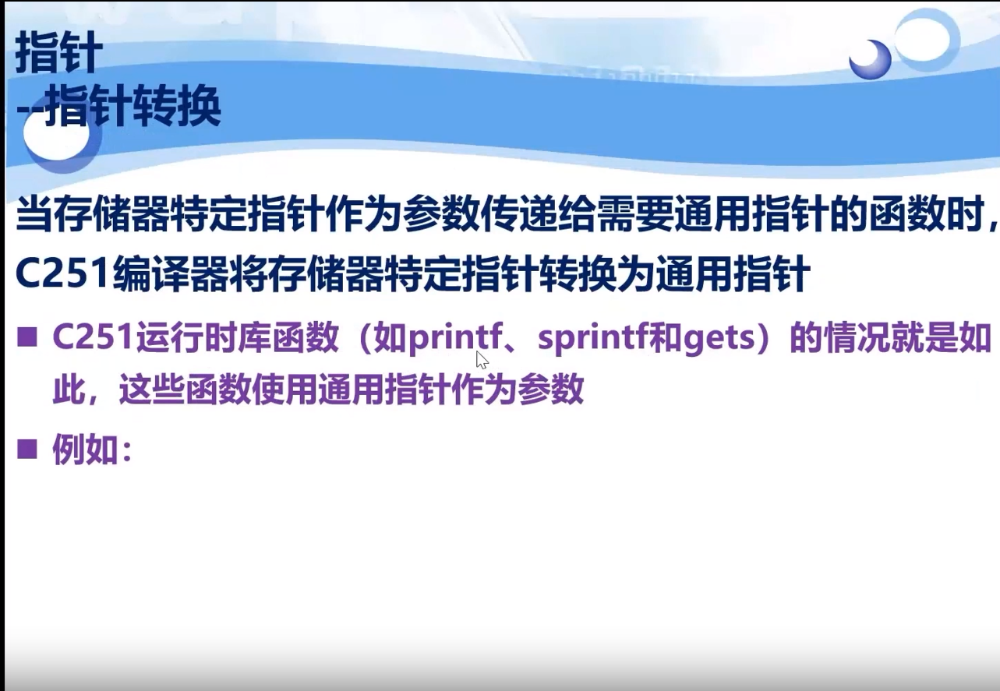
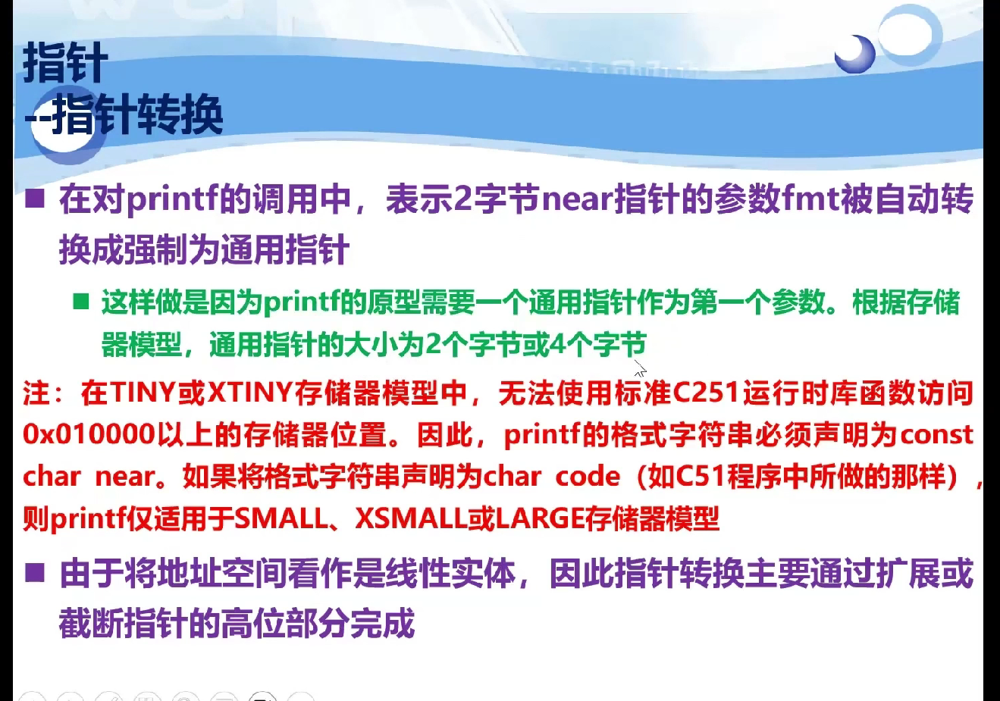
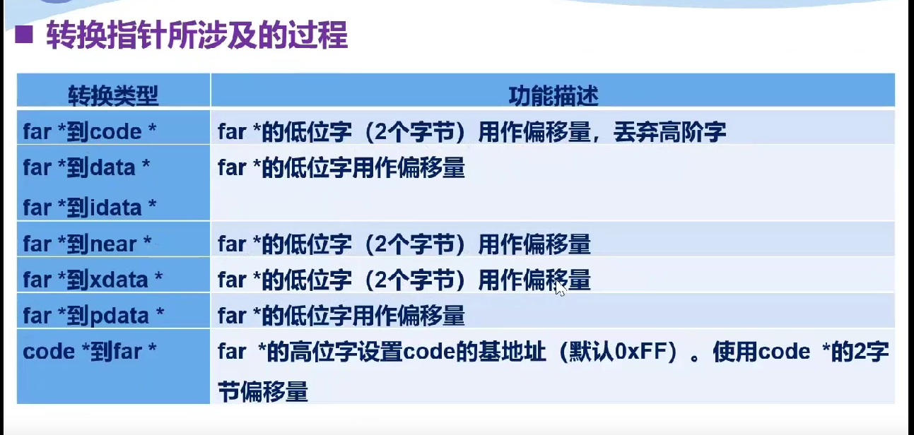
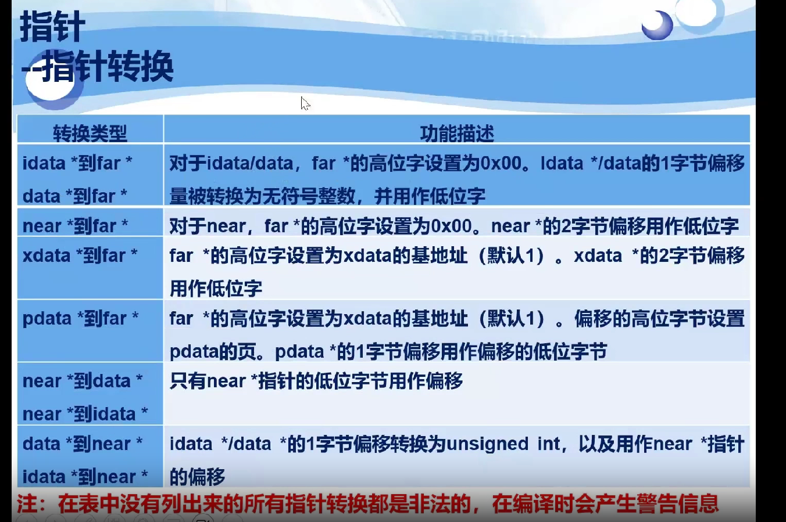
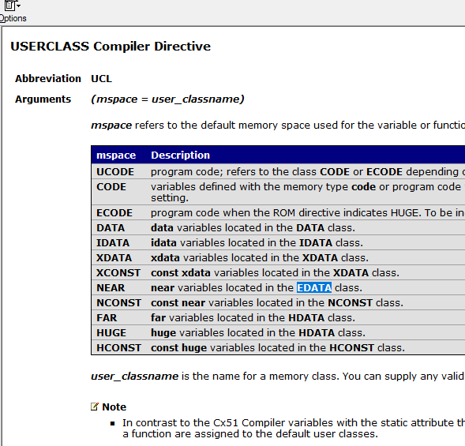

pdata,code

我就不知道printf打印的时候会把所有指针转成默认指针类型，tnnd我说看文档怎么都和我打印的东西对不上，最后还得听它语速慢没字幕的课。。。

near和edata是同一个东西

引用edata/near  xdata区域的指针都是16位的
edata/near -> far指针，0x00基地址+16位偏移量
xdata -> far指针，0x01基地址+16位偏移量

far -> xdata指针 只保留最后16位偏移量
far -> edata指针 只保留最后16位偏移量
